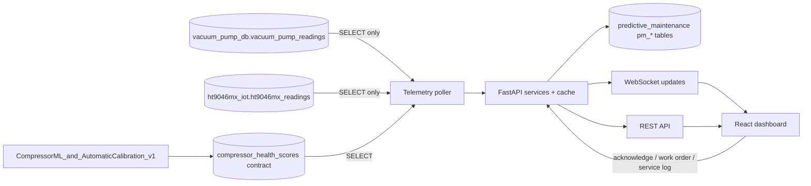
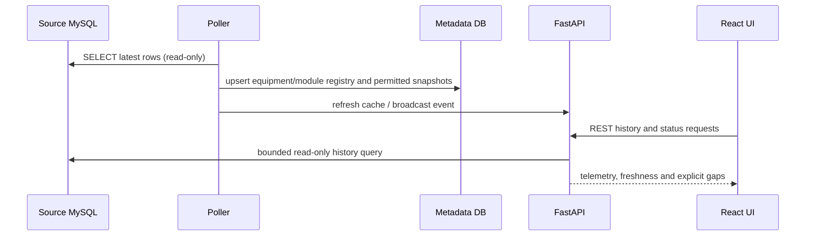
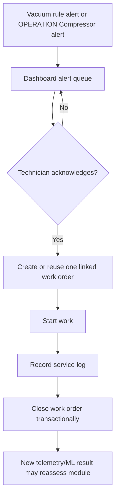
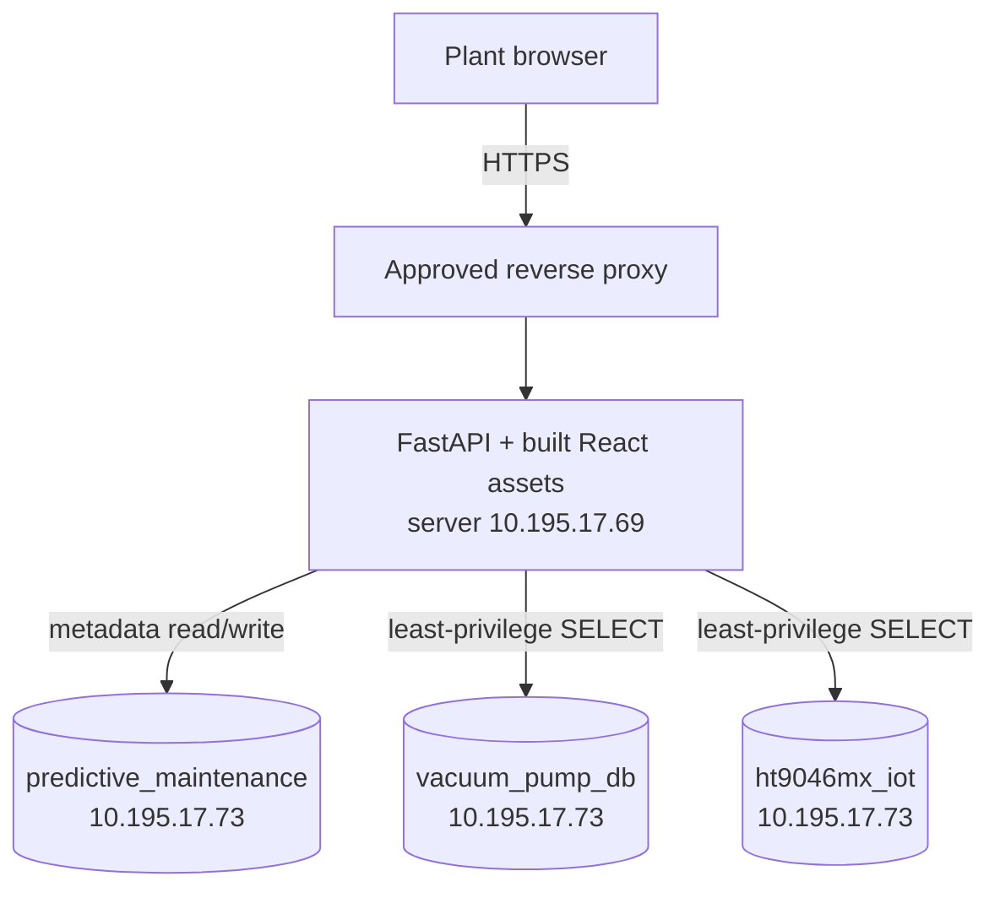

# Compressor and Vacuum Pump Operations Dashboard v1

**Repository:** `Bookkapp/Compressor_and_VacuumPump_v1`
**Snapshot date:** 2026-09-24
**Purpose:** FastAPI + React operations dashboard for Compressor and Vacuum Pump telemetry, alerts, work orders and service records.

This is a server handoff for the current architecture. It does not authorize deployment to the plant network.

## 1. System boundary

The dashboard reads live telemetry from MySQL, presents trends and equipment state, consumes Compressor ML output from `CompressorML_and_AutomaticCalibration_v1`, and manages acknowledgement, work orders and maintenance logs. It has no PLC/control write path.

Vacuum Pump status is rule-based. Compressor status is supplied by the separate ML/calibration system; this application must show `Awaiting ML Score` when no valid score exists and must not invent a placeholder health score.

## 2. Context and data flow

## 3. Source and integration contract

| Source | Access | Identity / time | Main fields |
| --- | --- | --- | --- |
| `vacuum_pump_db.vacuum_pump_readings` | read-only | `devices_id`, `recorded_at` | temperature, acceleration, vibration, current |
| `ht9046mx_iot.ht9046mx_readings` | read-only | `machine_number`, `recorded_at` | global Status and Module 1–8 pressure, valve, temperature, status, busy and SV fields |
| `compressor_health_scores` compatibility contract | read-only | `machine_number`, `module_id`, `recorded_at` | `health_score`, `condition`, `model_version` |
| `predictive_maintenance.pm_*` | dashboard read/write except Compressor alert producer rules | relational IDs and timestamps | registry, diagnostics, alerts, work orders and maintenance audit |

The Compressor score identity is `machine_number + module_id + recorded_at`. Machine aliases such as `057`, `MX057` and `HT9046MX-057` must resolve to one dashboard device. `module_id` is `compressor-m1` through `compressor-m8`.

The current compatibility table lives in `ht9046mx_iot`, although that schema is otherwise source read-only. This is a v1 integration debt. Moving it to `ht9046mx_analytics` or a dedicated output schema requires a coordinated contract version in both repositories.

## 4. Metadata schema

| Table | Writer / purpose |
| --- | --- |
| `pm_users` | dashboard authentication and roles |
| `pm_devices` | shared Handler/equipment registry and latest overall state |
| `pm_modules` | Compressor M1–M8 and Vacuum Pump modules |
| `pm_sensor_readings` / `pm_sensor_metrics` | optional locally persisted/dashboard-derived values; live history normally stays in source tables |
| `pm_diagnostic_snapshots` | time-stamped health/condition snapshots used by overview and history |
| `pm_alerts` | Vacuum alerts from dashboard rules; Compressor alerts from OPERATION only |
| `pm_work_orders` | actionable work, optionally linked one-to-one to a source alert |
| `pm_maintenance_logs` | technician service audit linked to device/module/work order |
| `pm_system_settings` | operational settings such as alert-clear boundary |

The dashboard acknowledges alerts and creates work orders. It must not create a second Compressor alert for the same ML episode. It must not delete alert history merely to deduplicate, because work orders retain the source alert relationship.

## 5. Runtime workflows

### Live read and display

The service may poll source health frequently, while the Compressor ML producer publishes a new score on its five-minute cadence. Freshness is displayed separately from equipment condition.

### Alert to maintenance record

## 6. Status semantics

The UI vocabulary is Good, Warning, Repair now, Repairing and Offline. `Repairing` is workflow state; it must not overwrite fresh source evidence permanently. After a service log closes a work order the module returns to Good, but a subsequent ML/rule result can move it back to Warning or Repair now.

Vacuum `Estimated Pressure` is derived from vibration and must never be called measured pressure. Compressor anomaly/health output is decision support, not a confirmed fault cause.

## 7. Deployment topology

### Server setup

1. Clone this private repository and check out tag `v1.0.0-current-architecture` on the approved application server.
2. Install Python dependencies from `requirements.txt` and Node dependencies from `package-lock.json`.
3. Copy `.env.example` to `.env` on the server. Use a unique 32+ character `SECRET_KEY`, distinct strong bootstrap passwords, a metadata database writer, and separate source `SELECT` accounts.
4. Set `APP_ENV=production`, `APP_TIMEZONE=Asia/Bangkok`, source schema/table names and the agreed sensor scale. Never commit `.env`.
5. Apply `schema.sql` and application migrations to staging after backup. Confirm foreign keys and indexes.
6. Run `python -m pytest -q` and `npm run frontend:build`.
7. Start one supervised API process first. If scaling to multiple workers, move polling to a singleton process and use shared pub/sub/cache so polling and writes do not duplicate.
8. Put the app behind the approved HTTPS reverse proxy. Verify login throttling, token/session revocation, security headers, least privilege and backup/rollback.
9. Run staging integration with both sources and OPERATION: timezone/freshness, alias resolution, Compressor alert ownership, acknowledgement, work-order linkage, restart/replay and p95/p99 load.
10. Deploy to `10.195.17.69` only after UAT and the gates in `SOT.md`/`ROADMAP.md` pass.

## 8. Failure behavior

- A source connection failure is shown explicitly; cached data is marked stale rather than presented as current.
- Missing Compressor ML output shows `Awaiting ML Score`.
- A stale or invalid score must not silently change into Good.
- Gaps in historical telemetry remain gaps.
- Database credentials and connection strings are never returned by diagnostics.
- The application never writes to source telemetry tables.

## 9. Repository boundary

The v1 repository excludes `.env`, passwords, tokens, private keys, raw telemetry, local databases, `node_modules`, caches and generated temporary data. `public/` contains the built frontend assets required by the current FastAPI packaging; its authoritative source is `frontend/src/`. Mock and import scripts are staging/local tools only and must be pointed at isolated schemas.

## 10. Cross-repository change control

Changes to the Compressor score table, condition vocabulary, alias mapping, module identity, timestamp timezone, freshness policy or alert ownership require matching changes and tests in `CompressorML_and_AutomaticCalibration_v1`. Publishing either repository does not activate a model, approve a calibration profile, restart a service or grant production database access.
